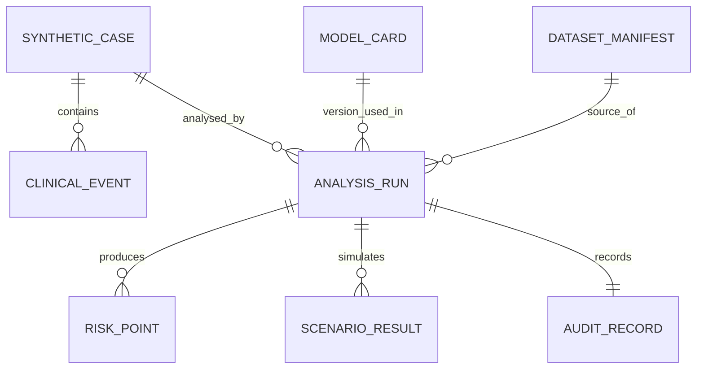

# HyunDPCR — Data Model, Test Matrix & Reproducibility v1.0

**기준:** 2026-11-13 · **현재 구현 상태:** 명세만 작성됨 · **대상 데이터:** 합성 데이터(SYNTHETIC_DEMO)

## 1. 최상위 객체

| Entity | Required fields | Constraints |
|---|---|---|
| SyntheticCase | case_id, is_synthetic, cohort_id | no real patient IDs; is_synthetic must be true in MVP |
| ClinicalEvent | event_id, case_id, event_type, clinical_time, recorded_at, available_at, code, source | timezone-aware; keep clinical vs record vs available timestamps distinct |
| DatasetManifest | dataset_id, version, seed, provenance, synthetic_generator_version | immutable version; no clinical performance claims |
| ModelCard | model_id, version, endpoint, horizon_supported, validation_status, intended_use, limitations | MVP model status must be TOY_ONLY |
| AnalysisRun | run_id, case_id, analysis_mode, as_of, horizon_days, model_id, dataset_id, seed, parameters, warnings | input hash/version; deterministic reproduction |
| RiskPoint | as_of, horizon_days, estimate/status, interval/status | estimate in [0,1] when present; explicit no-estimate alternative |
| ScenarioResult | scenario_id, action_assumptions, capacity, seed, simulated_outputs | not causal effect or clinical decision |
| AuditRecord | run_id, generated_at, data_cutoff, code_version, warnings, export_manifest | tamper-evident after future design; no PHI |

## 2. Event time correctness

**Invariant I-01:** Feature engineering receives only events `available_at <= as_of`.

**Invariant I-02:** Event records may arrive late or be corrected; recalculations use the dataset version and `as_of` snapshot. Historical results from different dataset versions are not silently compared.

**Invariant I-03:** Symptoms' `reported_onset_at` (patient history) may precede `recorded_at`; missing onset is missing, not `recorded_at`.

**Invariant I-04:** A test has at least distinct order/collection/result availability dates where known; a result obtained after `as_of` cannot be used to predict earlier `as_of`.

**Invariant I-05:** Future cancer registry labels are stored in evaluation-only tables, and unavailable to feature pipeline.

**Invariant I-06:** Multiple diagnoses / other causes / death / loss to follow-up require predefined event hierarchy; don't sum subtype risks as independent probabilities.

**Invariant I-07:** Endpoint names include diagnosis vs incidence vs stage/progression; MVP supports recorded diagnosis only.

**Invariant I-08:** All model outputs include `analysis_mode`, `endpoint`, `as_of`, `horizon`, version and watermark.

## 3. Test-driven delivery plan

| Test ID | Unit / integration / UI | Input and setup | Assert |
|---|---|---|---|
| UT-01 | unit | event at as_of+1 day | excluded from features |
| UT-02 | unit | case with unknown onset | no inferred onset date |
| UT-03 | unit | event with no availability timestamp | fails closed |
| UT-04 | unit | seed=173, same version/config | byte-identical calculation payload (excluding wall-clock timestamp) |
| UT-05 | unit | horizon=0 or negative | rejected with clear validation message |
| UT-06 | unit | probability below 0 or above 1 | rejected; never clipped silently |
| UT-07 | unit | competing event cumulative incidence | total probability never exceeds 1 within numerical tolerance |
| UT-08 | unit | no test sensitivity/harm/cost | options result unavailable, no invented recommendation |
| INT-01 | integration | run synthetic case through service → reporting | output contract matches schema and watermark present |
| INT-02 | integration | inject future diagnosis label | earlier as_of prediction unchanged |
| INT-03 | integration | swap dataset version | old run metadata remains linked to old version |
| INT-04 | integration | simulate with missing permissible action set | decision calculation blocked |
| INT-05 | integration | change Streamlit form input | new run ID/result; old report unchanged |
| UI-01 | Streamlit AppTest | start Home.py with fixtures | no exceptions; synthetic banner visible |
| UI-02 | Streamlit AppTest | navigate to risk page | horizon and endpoint consistently visible |
| UI-03 | Streamlit AppTest | export sample | report contains synthetic notice and model/data versions |
| SEC-01 | static checks | repository files | no credentials / real patient data |
| SEC-02 | security | synthetic-only data loader | rejects user-uploaded unapproved patient file |
| A11Y-01 | manual | 200% zoom + keyboard | all critical content and main interactions usable |
| A11Y-02 | manual | graph colors unavailable | table/text still contains information |

**Each test is a proposed acceptance test**, not a report of completed validation.

## 4. Clinical research transition gate

Only after proper IRB/DUA and data rights:
1. Freeze outcome code set and cohort eligibility before model training.
2. Separate model development from temporal/external evaluation.
3. Compare baseline and extended models on same population and horizon.
4. Report discrimination, calibration, threshold-level tradeoffs, net benefit and uncertainty.
5. Review fairness/shift by sex, age, region and other appropriate subgroups.
6. Study informative testing/visit selection and differential ascertainment.
7. Do not interpret a simulated waiting-time improvement as proven patient outcome benefit.

Clinical authorization is **not** unlocked by passing engineering tests.

## 5. Test toolchain

- pytest for unit, property-style invariants, integration.
- `streamlit.testing.v1.AppTest` for multipage UI smoke/interaction tests.
- Ruff for lint/format; dependency and secret scanning in CI.
- Pinned requirements or lockfile with reproducible Python environment.
- Two CI job classes: `unit-and-contract` (every push/PR) and `ui-synthetic-smoke` (every PR).
- Document platform-specific model/numerical tolerances; no unqualified bit-identical claims across different BLAS/platforms.

References: [Streamlit AppTest](https://docs.streamlit.io/develop/concepts/app-testing), [TRIPOD+AI](https://doi.org/10.1136/bmj-2023-078378), [PROBAST+AI](https://doi.org/10.1136/bmj-2024-082505).
