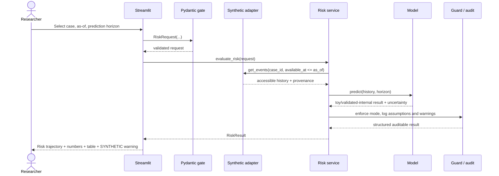
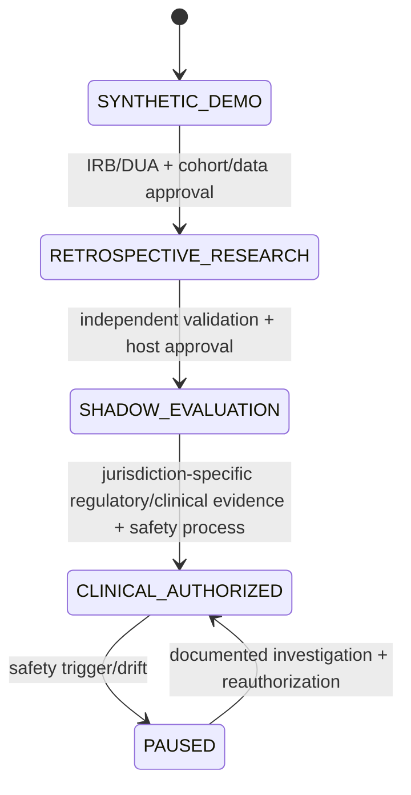

# HyunDPCR — Implementation Blueprint v3.0

**Date:** 2026-11-13 · **Stage:** implementation-ready specification, **not deployed** · **Stack:** Python 3.12 + Streamlit (synthetic-data only)

## 0. Product contract and architecture decisions

- **Product:** Research-first platform for evaluating time-updated *recorded cancer diagnosis* risk and hypothetical diagnostic pathways in adults presenting with non-specific symptoms.
- **Never claim:** predicting biological cancer onset, tumour growth, stage transitions or patient survival, nor giving validated individual clinical advice.
- **MVP design:** a single Streamlit process, typed Python domain service, seeded synthetic events, and no external API/database/PII.
- **Future target:** institutional research service, with optional FastAPI, database, FHIR adapters, tenant/role controls and compliance gates **only when justified**.
- **Design invariants:** all features used by an estimate were available at `as_of`; output mode `SYNTHETIC_DEMO`; non-clinical watermark persists in every chart/table/export; no automatic test/referral advice.
- **Implementation reality:** As of the document revision, these are design requirements, not implemented or tested features.

## 1. Domain-driven module boundaries

| Package | Responsibility | Forbidden |
|---|---|---|
| `hyundpcr.schemas` | Pydantic events/requests/results; validation and explicit time zones | UI logic or implicit coercion of unknown clinical data |
| `hyundpcr.data` | synthetic cohort; coding, availability filtering, provenance checks | recording identifiable users or real patient records |
| `hyundpcr.models` | fixed-horizon baseline, landmark survival and competing-risk candidates | interpreting simulated scores as externally validated risk |
| `hyundpcr.quant` | conditional probability, uncertainty, Monte Carlo, VOI and tail scenarios | converting money loss directly into clinical utility without specification |
| `hyundpcr.simulation` | encounter→testing→referral→diagnosis/censor state simulator and queue | treating hypothetical delays as evidence of causal clinical harm reduction |
| `hyundpcr.governance` | permitted-action gate, audit, mode separation, model/data cards | overriding emergency referral guidelines with an optimizer |
| `hyundpcr.services` | typed orchestration; pure/reproducible analysis calls | importing Streamlit or accessing databases directly |
| `hyundpcr.reporting` | watermarked CSV/JSON/HTML study exports | omitting assumptions, horizon or synthetic status |
| `app` | Streamlit interface, navigation, chart+table, accessible explanations | embedding risk math or clinical cutoff rules in widgets |

**Dependency direction:** Streamlit → services → typed schemas / independent domain packages → synthetic data adapter; services → reporting/governance. Domain packages **never** import UI. Do not add an HTTP microservice hop to the MVP.

## 2. Proposed folder tree

```text
app/
  Home.py
  pages/
    01_Cohort_Overview.py
    02_Patient_Timeline.py
    03_Risk_Evolution.py
    04_Pathway_Simulator.py
    05_Options_Lab.py
    06_Validation_Audit.py
  components/
    disclaimer.py
    evidence_table.py
    risk_chart.py
src/hyundpcr/
  schemas/{event.py,requests.py,results.py}
  data/{synthetic.py,filtering.py}
  models/{baseline.py,landmark.py,competing_risks.py}
  quant/{uncertainty.py,voi.py,monte_carlo.py,tail_risk.py}
  simulation/{states.py,queue.py}
  governance/{safety_gate.py,provenance.py,audit.py}
  services/{risk.py,pathway.py,options.py}
  reporting/{exports.py,model_card.py}
tests/{unit,leakage,safety,integration,ui}
examples/synthetic/
docs/
pyproject.toml
.gitignore
.github/workflows/ci.yml
```

**Build order:** directory skeleton and baseline → two functional screens (Overview / Risk Evolution) → audit and exports → timeline → pathway → conditional VOI. Pathway/Options must not be presented as finished in the first release.

## 3. Execution flow (single patient research scenario)



### 3.1 Input and output contract

```json
{
  "request": {
    "analysis_mode": "SYNTHETIC_DEMO",
    "synthetic_case_id": "CASE-0042",
    "as_of": "2026-03-01T00:00:00Z",
    "horizon_days": 90,
    "model_id": "demo-baseline-v1",
    "random_seed": 173
  },
  "result": {
    "analysis_mode": "SYNTHETIC_DEMO",
    "endpoint": "first recorded cancer diagnosis within horizon",
    "as_of": "2026-03-01T00:00:00Z",
    "horizon_days": 90,
    "estimate": null,
    "interval": null,
    "model_version": "demo-baseline-v1",
    "dataset_version": "synthetic-v1",
    "event_cutoff": "2026-03-01T00:00:00Z",
    "run_id": "deterministic-reproduction-key",
    "warnings": ["SYNTHETIC RESEARCH DEMO — NOT FOR CLINICAL USE"],
    "assumptions": []
  }
}
```

`estimate=null` is a **schema example**, not a prediction. Real implementation requires either a calculated value with a named model/validation status or an explicit `unavailable` state. No implicit default numerical risk.

### 3.2 Event schema

`event_id`, `synthetic_case_id`, `event_type`, `clinical_time`, `recorded_at`, `available_at`, `reported_onset_at` (nullable), `code_system`, `code`, `value`, `unit`, `source`, `quality_flags` and `is_synthetic=true`.

- `clinical_time` is the event/observation time, not necessarily symptom onset.
- `recorded_at` is documentation time; `available_at` is when the model could have known it.
- Use timezone-aware ISO-8601 timestamps; UTC internally, explicit display timezone.
- `available_at > as_of` → exclude **before** feature engineering.
- Test order, sampling, result release, referral and eventual registry diagnosis are independent events.
- Labels/outcomes are stored in an evaluation namespace not exposed as prediction features.
- Unknown symptom onset stays unknown; unknown result is **not** a negative test.

## 4. Mathematical workstreams and phase gates

### Signal (P0)

**First deliverable:** a deterministic **toy example**, not a clinical predictor. Display an explicit `toy_model` badge and no performance claims. After lawful real data access, compare:
- fixed-horizon logistic (handling censoring properly);
- time-landmark cause-specific/discrete-time survival;
- competing-risk cumulative incidence (cancer subtypes, other cancer, death);
- optional ML only when sufficient data and strong baseline established.

Risk contract: `P(recorded diagnosis by t+H | history available at t, no previous recorded cancer)`. Every plot point is conditional on its `as_of`; **do not** interpret the differences as the patient's biological disease progression.

### Pathway (P1)

State machine:
```text
FIRST_CONTACT -> FOLLOW_UP / INVESTIGATION / REFERRAL
FOLLOW_UP -> INVESTIGATION / REFERRAL / CENSORED
INVESTIGATION -> TEST_RESULT -> FOLLOW_UP / REFERRAL
REFERRAL -> REGISTRY_CONFIRMATION / NO_DIAGNOSIS / CENSORED
any nonterminal -> DEATH_OR_LOSS (if defined)
```
- Set admissible edges by scenario; don't fabricate patient-level clinical trajectories.
- Monte Carlo seeds and distribution parameter provenance must be in output.
- Report simulated time-to-action and waiting-time distributions, **not proved treatment effects**.
- Queue comparisons require fixed arrival process and explicit resource capacity, costs and censoring assumptions.

### Options (P1, after Pathway)

- VOI: compare expected loss **under an explicitly defined common utility scale** and a *clinically permissible* action set.
- Capture test sensitivity/specificity, acquisition delay, harms, cost, patient preference and prior uncertainty.
- No evidence for a material assumption → leave score unavailable, do not infer 'wait'.
- Show sensitivity analysis across multiple plausible inputs, not a single false-precision ranking.
- CVaR measures long simulated pathway delay, **not** cancer mortality without corresponding evidence.

### Guard (P0)

- Model registry status: `TOY_ONLY` / `RESEARCH_UNVALIDATED` / `EXTERNALLY_VALIDATED` (future) / `CLINICAL_AUTHORIZED` (future regulatory and governance workflow).
- Independent output audit: input hash, run hash, code version, timestamps/seed/horizon, warning, model card.
- Fail closed on missing data quality, accidental patient identifiers, undefined end point, missing as-of, invalid calendar sequence or safety-policy conflict.

## 5. Explicit state machine for the product



These are **governance phases**, not an automatic switch selectable by end users. No phase transition is implemented in MVP.

## 6. Quality gate: Definition of Done

- Clean install, `python -m pytest`, `python -m streamlit run app/Home.py` (after implementation).
- T01: Add/change a future-only event → earlier `as_of` result unchanged.
- T02: Same seed/data/model/schema version produces same values and stable run signature.
- T03: Missing `available_at`, negative horizon, invalid risk values fail validation.
- T04: Synthetic-warning shown in **every** screen and downloadable table.
- T05: Probability totals valid; competing risks follow numerical consistency checks.
- T06: No unapproved clinical suggestion; no default real-patient processing.
- T07: Export includes cohort/endpoint/as-of/horizon/mode/provenance/model caveat.
- T08: UI tested with Streamlit `st.testing.v1.AppTest`, browser keyboard/zoom/screen-reader spot checks.
- T09: Committed assets contain no secrets/identifiers; no external data calls required.
- T10: Reviewer can reproduce a named synthetic scenario and verify the exact sequence of events.

**Go/no-go:** Synthetic MVP requires **all P0 tests** passing; no 'accuracy' claims before suitable external clinical validation.

## 7. Delivery slices

| Milestone | Build | Exit evidence |
|---|---|---|
| A: Skeleton | packaging, schemas, data generator, tests, CI | Installation/reproducibility tests |
| B: Signal + Guard | baseline, risk evolution, model warning, audit | Time-leakage and model-status tests |
| C: Research UI | timeline, chart+table, export and accessibility | End-to-end Streamlit AppTest, manual a11y review |
| D: Pathway | state engine, seeded event simulator | time invariants / queue scenarios |
| E: Options | parameterized VOI engine, safety gate | impossible/missing assumptions block calculations |
| F: Research deployment | governance/DUA/IRB and independent validation | institution-approved retrospective evaluation |

**Do not write marketing claims from synthetic tests.** Passing unit tests is not clinical performance validation.

## 8. Engineering references

- [Streamlit multipage navigation](https://docs.streamlit.io/develop/concepts/multipage-apps/page-and-navigation)
- [Streamlit AppTest](https://docs.streamlit.io/develop/concepts/app-testing)
- [Streamlit caching](https://docs.streamlit.io/develop/concepts/architecture/caching)
- [TRIPOD+AI reporting](https://doi.org/10.1136/bmj-2023-078378)
- [PROBAST+AI quality](https://doi.org/10.1136/bmj-2024-082505)
- [NICE NG12: suspected cancer](https://www.nice.org.uk/guidance/ng12)
